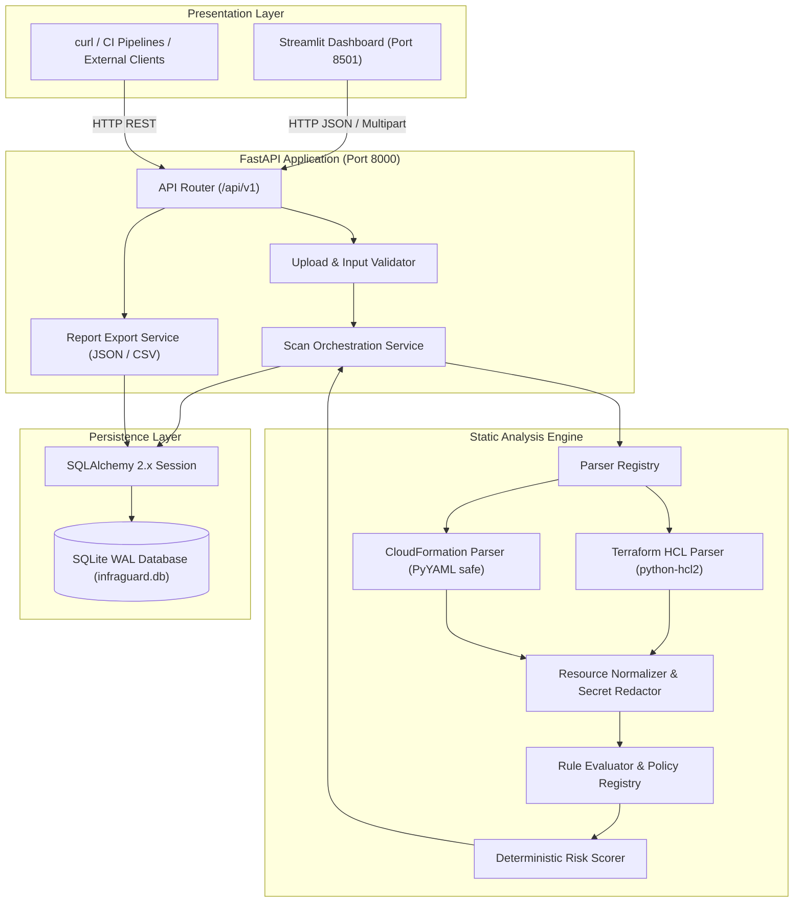
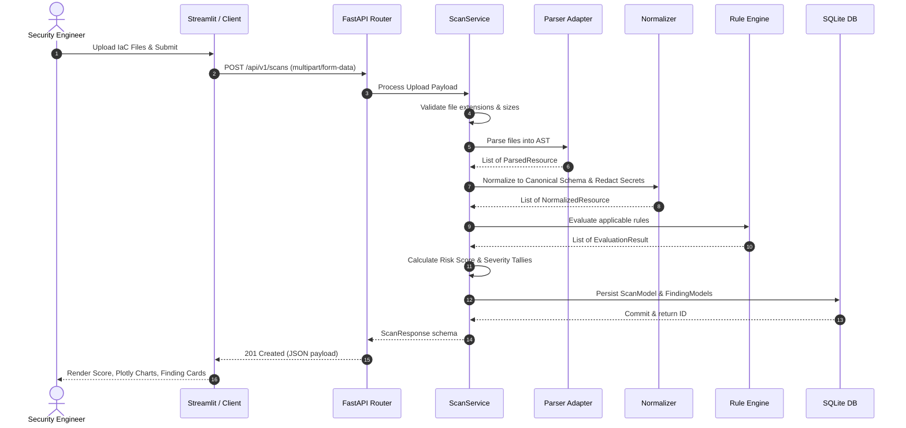

# InfraGuard — System Architecture Documentation

> **Status:** Production / Release-Ready  
> **Document Version:** 1.0.0  
> **Target Audience:** Security Engineers, Cloud Architects, Developers

---

## 1. Executive Summary

InfraGuard is an **API-first, multi-cloud Infrastructure-as-Code (IaC) security guardrail auditor**. It performs deterministic static analysis of cloud configuration templates across Amazon Web Services (AWS), Microsoft Azure, and Google Cloud Platform (GCP).

### Core Principles
1. **API-First & Fully Decoupled**: The core auditing engine and SQLite persistence layer are exposed via FastAPI HTTP endpoints. The Streamlit frontend is a pure HTTP consumer with zero imports from backend business logic.
2. **Deterministic Evaluation**: Pure functional rule checks guarantee that identical configuration files always produce identical findings and scores.
3. **No Execution / Offline Static Analysis**: IaC templates are parsed into abstract syntax trees without running shell commands, executing Terraform providers, or contacting live cloud provider APIs.
4. **Honest Coverage Semantics**: Unrecognized or unsupported resource types are explicitly marked `UNSUPPORTED` or `NOT_EVALUATED`—never falsely marked as `PASS` or compliant.

---

## 2. System Architecture & Component Diagram

---

## 3. Component Boundaries & Responsibilities

### 3.1 REST API Layer (`app/api/v1/`)
- **`health.py`**: Emits engine status, scanner version, policy version, and active database connection state.
- **`providers.py`**: Returns dynamic provider discovery catalog (`aws`, `azure`, `gcp`) and supported formats (`terraform`, `cloudformation`).
- **`rules.py`**: Queryable registry of all 25 active guardrails, supporting provider and severity query parameter filters.
- **`scans.py`**:
  - `POST /scans`: Accepts multipart file uploads with provider and format parameters. Enforces size limits, file extension filters, and path traversal sanitization.
  - `GET /scans`: Paginated history of prior scans.
  - `GET /scans/{id}`: Detailed inspection of a specific audit, including resource tallies, findings, and diagnostic notices.
  - `GET /scans/{id}/report`: Formatted export download in JSON or CSV.

### 3.2 Parser Layer (`app/parsers/`)
- **`TerraformParser`**: Parses `.tf` files using `python-hcl2`. Strips quotes, standardizes blocks, extracts resource identifiers, and records source file/line metadata.
- **`CloudFormationParser`**: Parses YAML and JSON templates using PyYAML `SafeLoader` augmented with AWS intrinsic constructors (`!Ref`, `!Sub`, `!GetAtt`, `!Join`, `!Select`).
- **`ParserRegistry`**: Validates file-extension compatibility and dispatches parsing jobs to the appropriate parser.

### 3.3 Normalization & Secret Redaction (`app/normalization/`, `app/core/redaction.py`)
- Maps vendor-specific resource types (`aws_s3_bucket`, `AWS::S3::Bucket`, `azurerm_storage_account`, `google_storage_bucket`) into canonical normalized types (`s3_bucket`, `storage_account`, `storage_bucket`).
- **Secret Redaction**: Recursively identifies sensitive keys (`password`, `secret`, `api_key`, `token`, `credential`, `private_key`) and embedded credential regex patterns (AWS keys, RSA keys), replacing them with `[REDACTED]` before evaluation.

### 3.4 Rule Engine & Baseline (`app/engine/`, `app/rules/`)
- Contains 25 pure functional security rules across AWS, Azure, and GCP.
- Rules implement `SecurityRule.evaluate(resource: NormalizedResource) -> EvaluationResult`.
- Outputs explicit statuses: `PASS`, `FAIL`, `NOT_EVALUATED`, and `UNSUPPORTED`.
- Evaluation evidence is automatically scrubbed by `EvaluationResult.__post_init__`.

### 3.5 Risk Scoring Engine (`app/scoring/`)
- Deterministic penalty calculation:
  $$\text{Risk Score} = \max\left(0, 100 - \sum \text{Finding Penalties}\right)$$
- Standardized penalties:
  - **Critical**: 25 points
  - **High**: 15 points
  - **Medium**: 7 points
  - **Low**: 2 points
- Risk Bands:
  - `90 - 100`: **LOW**
  - `70 - 89`: **MODERATE**
  - `40 - 69`: **HIGH**
  - `0 - 39`: **CRITICAL**

### 3.6 Persistence & Repository Layer (`app/models/`, `app/repositories/`)
- **SQLAlchemy 2.0** ORM models: `ScanModel` and `FindingModel`.
- Foreign key constraints, cascading deletes, and indexed lookup fields.
- SQLite WAL (Write-Ahead Logging) mode enabled by default with connection busy timeouts to eliminate concurrency locks.

### 3.7 Decoupled Frontend Layer (`dashboard/`)
- Streamlit application (`dashboard/app.py`) built exclusively on top of `dashboard/api_client.py`.
- No dependencies on SQLAlchemy, FastAPI internals, or rule implementations.
- Features interactive Plotly visualizations, dynamic provider/format selectboxes, client-side validation, and instant JSON/CSV downloads.

---

## 4. Data Flow

---

## 5. Security & Boundary Guarantees

| Boundary | Control | Guarantee |
|---|---|---|
| **File Ingestion** | Size limits & extension whitelist | Rejects files > 5MB, batch > 20MB, invalid extensions |
| **Path Traversal** | `os.path.basename` extraction | Prevents directory traversal attacks via filename manipulation |
| **Parsing Safety** | Safe YAML loader & AST parsing | No code execution or deserialization exploits |
| **Network Isolation** | Static parsing only | Zero outbound network calls to cloud providers |
| **Data Protection** | In-flight secret redaction | Passwords, tokens, and private keys never stored in plain text |
| **API Decoupling** | Pure HTTP boundary | Frontend cannot bypass server-side validation or corrupt database state |
