# InfraGuard — Threat Model & Security Assessment

> **Status:** Release-Ready  
> **Document Version:** 1.0.0  
> **Methodology:** STRIDE & DREAD Threat Modeling Frameworks

---

## 1. System Overview & Trust Boundaries

InfraGuard is an infrastructure-as-code security scanner. In the local MVP release, InfraGuard is designed for single-operator local use or secure internal CI runners.

```mermaid
flowchart LR
    UntrustedClient["Untrusted User / File Input"]
    Boundary1["[Trust Boundary 1: API Gateway & Upload Filter]"]
    APIServer["FastAPI Backend Process"]
    Boundary2["[Trust Boundary 2: Safe Memory-only Parsing Engine]"]
    Engine["AST Parser & Rule Engine"]
    Boundary3["[Trust Boundary 3: File System & Local DB]"]
    SQLite[("SQLite Database: infraguard.db")]

    UntrustedClient -->|Raw Files / HTTP| Boundary1
    Boundary1 --> APIServer
    APIServer --> Boundary2
    Boundary2 --> Engine
    Engine --> Boundary3
    Boundary3 --> SQLite
```

---

## 2. STRIDE Threat Analysis

| Category | Threat Description | Severity | Implemented Mitigation | Verification |
|---|---|---|---|---|
| **Spoofing** | Attacker impersonates an authorized security auditor or submits spoofed scan IDs. | Medium | MVP is explicitly scoped as an unauthenticated single-user local tool. Future OIDC/OAuth2 enterprise controls designed in `PRD.md §14`. | Documented local boundary; strict UUID-based scan identifiers. |
| **Tampering** | Directory traversal via malicious filename uploads (e.g. `../../etc/passwd`). | High | Filename paths are sanitized via `Path(filename).name` and `os.path.basename`. Files are read into memory buffers without disk writes. | Tested in `tests/security/test_upload_validation.py`. |
| **Repudiation** | Audit history being altered or deleted without trace. | Medium | SQLite persistence stores immutable scan records and findings with ISO timestamps. Scans cannot be updated once saved. | Verified in `tests/integration/test_persistence_restart.py`. |
| **Information Disclosure** | Plaintext credentials, private keys, or API tokens exposed in findings, reports, or terminal logs. | High | In-flight secret redaction scrubs passwords, access keys (`AKIA...`), and RSA private keys before findings and normalized properties are recorded. | Tested in `tests/unit/test_redaction.py`. |
| **Denial of Service** | Oversized file uploads, zip bombs, or deeply nested YAML/HCL structures causing resource exhaustion. | High | Strict 5MB single file limit, 20MB batch limit, 50 file count limit, and memory-only parsing without filesystem decompression. | Tested in `tests/security/test_upload_validation.py`. |
| **Elevation of Privilege** | Arbitrary code execution via unsafe YAML deserialization or dynamic Terraform evaluation. | Critical | Enforced PyYAML `SafeLoader` (safe against `!!python/object`). Pure AST parsing via `python-hcl2`. No execution of shell commands or `terraform` binaries. | Tested in `tests/unit/test_parsers/test_cloudformation.py`. |

---

## 3. Specific Attack Vectors & Mitigations

### 3.1 Malicious Uploaded Configuration
- **Risk**: An attacker submits a configuration file crafted with malicious syntax designed to trigger code execution.
- **Mitigation**: InfraGuard does not execute IaC templates or invoke Terraform/CloudFormation runtime binaries. All files are parsed into abstract syntax data structures (ASTs) using memory-safe parsers (`python-hcl2` and PyYAML `SafeLoader`).

### 3.2 Path Traversal & File Upload Exploits
- **Risk**: Filenames such as `../../../var/log/malicious.tf` could attempt to overwrite host system files or trigger path resolution vulnerabilities.
- **Mitigation**: Filenames are sanitized using `Path(f.filename).name` which completely strips all directory path prefixes. Furthermore, file bytes are decoded in memory (`f.read()`) rather than being written to arbitrary filesystem locations.

### 3.3 Parser Abuse & YAML Deserialization Exploits
- **Risk**: Unsafe YAML loaders (like standard `yaml.load`) can deserialize arbitrary Python objects, allowing Remote Code Execution (RCE).
- **Mitigation**: CloudFormation parser strictly subclasses PyYAML's `SafeLoader`. Standard safe constructors are augmented only with custom AWS intrinsic scalar/sequence constructors (`!Ref`, `!Sub`, `!GetAtt`), completely disallowing arbitrary Python type instantiation.

### 3.4 Secret Leakage in Findings & Reports
- **Risk**: Terraform and CloudFormation files often inadvertently contain hardcoded test passwords, database connection strings, or cloud access keys that could leak into audit reports.
- **Mitigation**: `app.core.redaction` inspects all property dictionaries and evidence strings. Any sensitive key name (`password`, `secret`, `token`, `api_key`, `credential`, `private_key`) or credential regex pattern is scrubbed and replaced with `[REDACTED]` or `[REDACTED_SECRET]` prior to report generation and persistence.

### 3.5 Outbound Cloud Network Isolation
- **Risk**: Security scanner contacting public cloud endpoints, leaking sensitive customer infrastructure topologies or incurring unintended cloud API fees.
- **Mitigation**: Pure offline static analysis. No AWS, Azure, or GCP SDKs are installed or invoked. All tests run hermetically without internet access or cloud credentials.

---

## 4. DREAD Risk Assessment Matrix

| Threat Vector | Damage | Reproducibility | Exploitability | Affected Users | Discoverability | DREAD Score | Risk Level |
|---|:---:|:---:|:---:|:---:|:---:|:---:|:---:|
| Arbitrary Code Execution via Parser | 10 | 1 | 2 | 10 | 2 | **5.0** | Medium (Mitigated) |
| Path Traversal via Upload | 8 | 1 | 2 | 10 | 3 | **4.8** | Medium (Mitigated) |
| Plaintext Secret Disclosure in Reports | 8 | 2 | 3 | 10 | 4 | **5.4** | Medium (Mitigated) |
| DoS via Gigabyte Upload | 6 | 1 | 2 | 10 | 3 | **4.4** | Low (Mitigated) |
| Exposure on Untrusted Public Network | 9 | 10 | 10 | 10 | 10 | **9.8** | **High (Documented Boundary)** |

---

## 5. Deployment Warnings & Known Limitations

> [!WARNING]
> **UNAUTHENTICATED LOCAL MVP WARNING**  
> The current MVP does not implement user authentication, OAuth2/OIDC, or multi-tenant database row isolation.
>
> - **DO NOT** bind the FastAPI backend or Streamlit frontend to public `0.0.0.0` interfaces on untrusted networks or the public internet.
> - Run the service locally (`127.0.0.1`) or within an authenticated private container / VPC perimeter.
> - For production multi-tenant deployments, follow the enterprise roadmap outlined in `PRD.md §14` (OIDC authentication, tenant isolation, and encrypted PostgreSQL).
